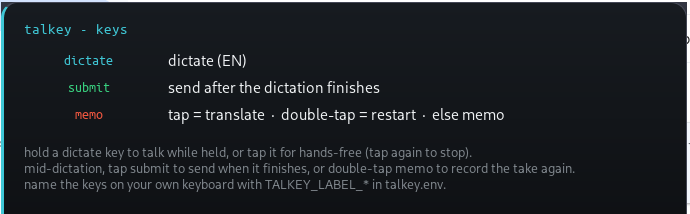

# talkey

Hold a key, speak, release. The text is typed into whatever window has focus.

Everything runs on your machine - whisper.cpp does the transcription, nothing is
uploaded, there is no API key and no account. For X11 with i3, or any window
manager that can bind a key's press *and* release.


A floating heads-up display shows the transcript forming as you speak, with a
live level meter. It never takes focus, so your text still lands in the window
you were working in.


On release the clean final text is typed, and the reading tells you how it went:
confidence, how much of the clip was silence, and your microphone's peak level.

## Contents

- [Why](#why)
- [What the keys do](#what-the-keys-do)
- [Install](#install)
- [Configuration](#configuration)
- [How it works](#how-it-works)
- [Microphone level](#microphone-level)
- [Vocabulary](#vocabulary)
- [Privacy: what is stored, and where](#privacy-what-is-stored-and-where)
- [Troubleshooting](#troubleshooting)
- [Contributing](#contributing)
- [Licence](#licence)

## Why

Dictation tools tend to be cloud services, or they take over your desktop, or
they only work inside one editor. talkey is a keybind. It types into the window
you are already in - a terminal, a browser, an editor, a chat box - and the
audio never leaves your machine.

It is built for long technical prose: prompts, commit messages, review comments,
issue descriptions. The things that are slow to type and easy to say.

## What the keys do

**Dictate** - hold to talk, release to type. Tap instead of holding and it goes
hands-free: tap once to start, again to stop. If you work in two languages, set
`TALKEY_LANG2` and bind a second key to `talkey dictate-alt` for it.

**Auto listening** - double-tap the dictate key (X on your controller) within
400 ms to keep listening in the background. Speech starts a phrase automatically;
By default, 1.2 seconds of silence or microphone mute finishes it, types the result and
returns to listening. Tap dictate during a phrase to finish it and
keep auto mode enabled. Tapping during final transcription leaves that result
alone. Tap while waiting for speech to turn auto mode off; `talkey auto stop`
or the status-bar toggle also cancels an unfinished phrase. Double-tapping toggles
auto mode without first starting a manual recording or finishing a phrase. Rising
and falling two-note sounds identify auto mode turning on and off. Single-tap
actions wait for the double-tap window (400 ms by default); when holding to talk,
wait for the recording tone before speaking. Key releases do not stop auto mode. The double-tap interval
and silence delay are configurable. Manual hold/toggle dictation still works.
For long thinking pauses, enable the optional Smart Turn detector described below.
Auto mode switches off after two minutes without speech, with the off sound.
Set `TALKEY_AUTO_IDLE_S` to change this timeout, or `0` to disable it. An unfinished
phrase or final transcription is allowed to finish before the idle timeout acts.

**Memo / translate** - on its own, hold to record and release to play the clip
straight back, so you can hear whether that came out right. During a dictation
the same key toggles **translate to English** for the clip: dictate in whatever
language you speak, tap it, and English lands in your window. whisper's
translate task only ever outputs English, so this is *your language* to English
and not the reverse - a limit of the model, not a setting. Tap it
twice quickly during a dictation and it **restarts** instead: the take so far is
thrown away and recording begins again, without letting go of the dictate key.

**Submit / cancel** - on its own, taps Enter. During a dictation each tap cycles
what will happen when you finish: send (type, then Enter) → cancel (throw it
away) → plain (type, no Enter) → round again. Nothing commits mid-sentence, so
you can tap, keep talking, and undo an accidental press by tapping again. The
HUD shows what is currently pending.

**Double-submit (Triangle)** toggles the persistent auto-mode Enter preference,
just like `command enter toggle` or the Polybar Enter control. The first tap waits
for the double-tap window, so a double tap does not also send Enter or cycle the
current phrase's submit/cancel state. Use separate single taps to cycle that state.
This works while auto mode is off, waiting, recording, or transcribing. Square's
double tap still restarts a manual recording.

In auto mode, submit (triangle) uses that same cycle. While waiting for speech,
it arms the next phrase instead of immediately pressing Enter. During speech or
final transcription, it changes the current phrase. Each phrase then resets to
the auto-mode Enter preference (initially `TALKEY_SUBMIT`, plain typing by default).
Memo/translate gestures during an auto
phrase are ignored; use manual dictation for translation or restarting a take.

**Help** - a cheat sheet of your own bindings, in a floating window.

### Setting up auto listening

Run `talkey-setup vad` to check the detector and print the model download command.
Auto mode needs Python 3, the whisper.cpp shared library with its VAD C API, and
`ggml-silero-v5.1.2.bin` from the
[official Whisper VAD model repository](https://huggingface.co/ggml-org/whisper-vad).
It uses the Silero model to recognize speech, independently of Whisper's final
transcription. All inference stays local. The normal Whisper server must also
be running. Setup does not download or install anything automatically.

The detector searches `~/.local/share/whisper`, the local whisper.cpp checkout's
`models` directory, and `/usr/share/whisper.cpp-model-silero-v5.1.2` for the model.
Set `TALKEY_VAD_MODEL` or `TALKEY_WHISPER_LIB` for other locations. Auto capture
uses 16 kHz mono regardless of the manual recording format. Useful settings:

| Setting | Default | Meaning |
|---|---|---|
| `TALKEY_VAD_THRESHOLD` | `0.5` | Minimum speech probability; increase to reject more background sound |
| `TALKEY_VAD_START_MS` | `160` | Sustained speech required to begin a phrase |
| `TALKEY_VAD_SILENCE_MS` | `1200` | Silence required to finish; increase for longer thinking pauses |

The worker retains a short pre-roll so detecting speech does not cut off its
beginning. Silence before speech is held only in a bounded memory buffer.
Capture continues during transcription, with up to 120 seconds of queued audio;
phrases are delivered in order. If transcription falls further behind, auto mode
reports an error and keeps the unfinished take without sending it. Each phrase
is capped by `TALKEY_MAX_REC_S`. Muting a connected microphone finishes a phrase;
disconnecting the device may require restarting auto mode after reconnecting.

### Thinking pauses with Smart Turn

`talkey-setup turn` checks the optional semantic turn detector and prints the
commands to install an isolated Python environment and the pinned Smart Turn
v3.2 CPU model. Enable `TALKEY_SMART_TURN=1` and set `TALKEY_AUTO_PYTHON` to that
environment's Python executable, then restart auto mode. NumPy and ONNX Runtime
are the only additional Python dependencies; neither a cloud service nor
PyTorch/Transformers is required. The model is about 9 MB.

Silero first identifies a pause. Smart Turn then checks the most recent eight
seconds of speech audio, using cues from what you said and how you said it.
It does not consume the Whisper transcript. The default policy is:

- A completion probability of at least **0.9**, followed by at least **2 seconds**
  of silence, allows the phrase to finish.
- Otherwise the same phrase stays open for up to **20 seconds** of silence.
  The HUD/status shows `paused`; resuming speech keeps the same take and resets
  the silence timer. No text or Enter is sent while the phrase is held open.
- Twenty seconds of continuous silence finishes even an uncertain phrase.
  `TALKEY_MAX_REC_S` also remains a hard recording-duration limit.

These are predictions, not guarantees about your intent. A pause after a complete
sentence can still sound like the end of your turn. Increase
`TALKEY_TURN_MIN_SILENCE_MS` for more patience even when the model is confident,
or `TALKEY_TURN_MAX_SILENCE_MS` if twenty seconds is too short. Lower
`TALKEY_TURN_THRESHOLD` to finish more readily. `TALKEY_SMART_TURN=0` restores
the simpler silence-based behavior. `TALKEY_TURN_MODEL` overrides the model path,
which defaults to `$XDG_DATA_HOME/talkey/models/smart-turn-v3.2-cpu.onnx`
(`~/.local/share/talkey/models/…` when unset).

Capture continues during the model check. If speech resumes, its earlier
completion prediction is discarded. Each take's `turn.json` records the latest
probability and whether it finished through a model decision, silence timeout,
or recording cap. Inference or microphone failures stop auto mode and retain
unfinished audio; they do not bypass turn detection and send a partial phrase.

Model and preprocessing sources: [Smart Turn](https://github.com/pipecat-ai/smart-turn),
[pinned model revision](https://huggingface.co/pipecat-ai/smart-turn-v3/tree/f766f81d3cfdf7737ac64aad813d91bbfd56bf93),
and [vendored feature extraction/licensing](lib/vendor/README.md).

### Explicitly finishing a phrase

Set `TALKEY_END_PHRASE="message complete"` in `talkey.env` and restart auto mode to
enable a spoken ending cue. Say your message, then “message complete,” then pause.
After 600 ms of silence, Talkey transcribes a snapshot of the last eight seconds
in the background. If its last words match the cue, the phrase finishes without
waiting for Smart Turn. Capture continues during this check; resumed speech
invalidates an older cue result. This also works with live HUD transcription disabled.

The usual full transcription still supplies the final text. A matching ending
cue is removed from it; the current Enter toggle decides whether to submit.
Saying only the cue produces neither text nor Enter. The cue is removed only
in auto mode, and only as an exact word suffix, ignoring case and punctuation.
If final transcription no longer contains it, that text is retained unchanged.

This is an explicit convention, not an intent classifier: naturally ending a
sentence with those same words will also match. A cue in the middle of a sentence
does not match. Recognition errors can miss the cue; tapping the dictate key
finishes the current phrase independently of speech recognition. Clear
`TALKEY_END_PHRASE` to disable the feature. `TALKEY_END_PHRASE_SILENCE_MS` adjusts
the pause before checking. Cue-request failures leave normal turn detection active.

### Configurable voice commands

Set `TALKEY_COMMANDS=1` in `talkey.env` to recognize commands in final dictation
transcripts. The included commands are `command enter on`, `command enter off`,
and `command enter toggle`. They change the persistent auto-mode Enter setting,
report the resulting state, and produce neither typed text nor an Enter keypress.
They work in manual and auto dictation. In auto mode you can append your ending
cue, for example “command enter off, message complete,” or tap dictate to finish.
The additional built-in `stop listening` (also `command stop listening`) switches
auto mode off without typing or pressing Enter. Its definition is
`stop-listening.json` and can be disabled or overridden like the Enter commands.
During a pause, a provisional transcript matching an enabled command can finish
the phrase promptly; only the final full transcript can execute the command.

Talkey ships definitions in `config/commands.d/` (`/usr/share/talkey/config/commands.d/`
when installed). Files in `~/.config/talkey/commands.d/` override matching filenames
or add commands. `TALKEY_COMMANDS_DIR` changes that user directory. Changes are
read on each final transcript. For example, disable the built-in toggle with
`~/.config/talkey/commands.d/enter-toggle.json`:

```json
{"enabled": false}
```

Override `phrases` to change or add spoken aliases. Or add an external script:

```json
{
  "phrases": ["command focus editor", "command show editor"],
  "exec": ["~/.local/bin/focus-editor"],
  "timeout_seconds": 10,
  "enabled": true
}
```

The script contains all desktop-specific behavior. Talkey executes the configured
argument list directly, without a shell or any speech-derived arguments. Scripts
run in the background with no command lock or stdin; they can call Talkey's CLI.
A notification reports success/failure, and `command.result.json` in the take
directory records the exit status and output. The timeout defaults to ten seconds
and can be set up to 120 seconds. `TALKEY_COMMANDS=0` restores ordinary dictation.

Matching ignores case and punctuation but requires the whole phrase. Registered
phrases start with `command`, with `stop listening` as the explicit exception.
Unknown or disabled commands are retained
as transcripts and reported without being typed or submitted. “Dictate command
enter on” types the literal words “command enter on.” “Dictate stop listening”
also types those words literally. Mentioning a command inside
a longer sentence remains ordinary dictation. Duplicate aliases and malformed
definitions produce a configuration error instead of running an ambiguous action.

### External status bars

The executable exposes commands for a separate Polybar module or another client:

```sh
talkey auto start
talkey auto stop
talkey auto toggle
talkey auto status
talkey auto enter-toggle
# Explicit choices are also available:
talkey auto enter-on
talkey auto enter-off
```

`status` prints one JSON object and does not open the microphone:

```json
{"enabled":true,"state":"listening","submit":"type","speech_ended":true,"enter_enabled":false}
```

`state` is `off`, `starting`, `listening`, `speaking`, `paused`, `transcribing`, or `error`.
`paused` means an existing phrase is still open while semantic completion is checked
or the worker waits for you to continue; `listening` means there is no open phrase.
`submit` is `type`, `send`, or `cancel`. `speech_ended` becomes true when an
utterance ends and stays true until the next one begins. The same endpoint is
recorded in the take's `speech.ended` marker. Poll `status`, or watch
`$STATE_DIR/session.changed` and refresh it on changes. Polybar configuration
lives outside this project. Auto mode runs until stopped or the worker fails;
enabling it does not install a login service.

`enter_enabled` is the default for every automatic phrase. The Enter commands
can change it while auto mode is off, waiting, recording, or transcribing; they
never press Enter immediately. A change also updates an active phrase unless it
has been explicitly cancelled. The preference is stored in
`${XDG_STATE_HOME:-~/.local/state}/talkey/auto-enter` and survives listener restarts
and logins until changed. Triangle still overrides
one phrase, and manual dictation still uses `TALKEY_SUBMIT`. Enter is sent only
after successful, nonempty transcription and insertion into the target window.



The rows are named by role out of the box. Set `TALKEY_LABEL_*` in
`talkey.env` and they read as the keys printed on your own keyboard instead -
the sheet is the one place that knows what you bound.

Start, stop and submit each play a short tone, so you know the state without
looking.

## Install

### Arch Linux

```bash
yay -S talkey-git
talkey-setup
```

`talkey-setup` asks the two questions no documentation can answer for you: which
speech model you want (they range from 142MB to 1.6GB, and the right one depends
on whether you have a GPU), and which keys you want to talk on - you press them,
it reads the keycodes. It then tells you how to get the model you picked, starts
the speech service, and writes the bindings file. Safe to re-run;
`talkey-setup keys` rebinds later.

It installs nothing for you. A model is an install however it arrives, and your
package manager is yours - so setup names the model, prints the AUR package, the
official `download-ggml-model.sh` command and the direct URL, and leaves the
choice of which to run to you.

`eww` comes with it, and is a real dependency rather than a nice-to-have -
without the HUD you dictate blind, with only tones and notifications. It is
AUR-only, so `makepkg -si` on its own cannot resolve it; an AUR helper can, or
install `eww` first.

### Already running whisper yourself?

Then skip all of it. talkey talks to a whisper.cpp server over HTTP, so point it
at yours and it never touches a model, a path, or a systemd unit:

```bash
TALKEY_WHISPER_URL=http://your-host:8910/inference
```

Set that in `~/.config/talkey/talkey.env`. Otherwise talkey starts a server for
you (`talkey-whisper.service` runs `talkey-whisper-server`, which resolves the
binary and the model), and that is the only reason it needs to know about models
at all.

### From a checkout

```bash
git clone https://github.com/yogh-io/talkey && cd talkey
setup/install.sh
```

The installer does the two things a package cannot - builds whisper.cpp into
`~/.local/opt/whisper.cpp` if no packaged copy exists, and installs the systemd
user units pointing at your checkout - then runs the same `talkey-setup`. Model,
service and keys are handled identically either way. Binaries and models live
outside the repo; only scripts and configuration are tracked.

Put `bin/` on your `PATH`, or use absolute paths in the key bindings.

### Bind your keys

`talkey-setup keys` does all of this - it reads your keycodes off the keyboard
and writes the file. The manual route, if you would rather:

1. Find the keycodes. Run this, then press each key with the `xev` window
   focused and read the number after `keycode`:

   ```bash
   xev | grep --line-buffered -oP 'keycode\s+\d+.*'
   ```

2. Copy the bindings and put your keycodes at the top of the copy:

   ```bash
   # installed from the AUR
   cp /usr/share/talkey/bindings/i3.conf ~/.config/i3/talkey.conf
   # from a checkout
   cp bindings/i3.conf ~/.config/i3/talkey.conf
   ```

3. Include it from `~/.config/i3/config`:

   ```
   include ~/.config/i3/talkey.conf
   ```

4. Reload i3 with `Mod+Shift+R`. Hold your dictate key, say something, release.

`talkey-setup` offers to add step 3 for you. It keeps a `.bak`, and i3's own
parser gets the veto - if i3 would reject the result your config is restored
exactly as it was. Say no and it prints the line for you to add yourself.

It also checks that the key you picked is not already bound to something else,
including in files your config `include`s, and names the file and line if it is.

Setup offers **Caps Lock** for dictate. It is the one key on every keyboard that
is reachable without moving your hand and does nothing anybody needs, so it is
the only default talkey suggests - and it stops being Caps Lock while talkey is
set up (`setxkbmap -option` with no argument undoes that).

Any key works. The ones that suit this best are keys you do not otherwise use,
within reach of a resting hand. Submit and memo have no default, because no key
is free on every keyboard and binding one you *do* use would be worse than
leaving it to you.

### Requirements

| | |
|---|---|
| Required | X11, `bash` 4+, `whisper-cpp`, `ffmpeg`, `xdotool`, `xset`, `curl`, `flock` (util-linux), and for the HUD `eww` + `inotify-tools` + `jq` |
| Sound | a PulseAudio-compatible server: PulseAudio itself, or PipeWire with `pipewire-pulse`. Recording is `ffmpeg -f pulse`, playback is `paplay`. |
| A speech model | `whisper.cpp-model-large-v3-turbo` (default), or any ggml model |
| Live text in the HUD as you speak | `python` - without it the HUD still shows state and the meter |
| Translate key | `whisper.cpp-model-small` - turbo dropped whisper's translate task |
| Key bindings | your window manager, or `sxhkd` / `xbindkeys` |
| Notifications | `libnotify` - the only feedback if you skip the HUD |
| Paste mode | `xclip` |
| Auto-titled recordings | `ollama` **and a model pulled into it** (`ollama pull qwen2.5:3b`), plus `jq` |

A GPU is not required, but `large-v3-turbo` really wants one. On CPU, use
`small.en` instead. With the CUDA toolkit installed, build a GPU copy from a
checkout - the build script is not part of the package - with
`WHISPER_CUDA=1 setup/build-whisper.sh`, then restart the service. Transcription
then comes back in well under a second. The build asks your card which
architecture to target, so there is nothing to configure.

A build in `~/.local` always wins over the distro package, so a GPU rebuild is
never quietly undone by the CPU-only build the package depends on.
`talkey-whisper` logs which binary and model it chose.

## Configuration

Everything is configurable, and every default already works. Nothing here needs
setting to use talkey.

Settings live in `~/.config/talkey/talkey.env`:

```bash
mkdir -p ~/.config/talkey
cp /usr/share/talkey/config/talkey.env.example ~/.config/talkey/talkey.env
```

The format is `KEY=value`, one per line, with `#` comments and optional
single or double quotes. Double quotes support escaped quotes and backslashes.
Values are literal: no shell code or variable expansion runs. This is a small
format shared by all commands and services, not the full systemd
`EnvironmentFile` syntax. Only `TALKEY_*` names are read. Anything already set in the environment wins
over the file, so a per-binding override still works:

```
bindcode $key_dictate exec --no-startup-id env TALKEY_LANG=de talkey dictate press
```

Key bindings themselves live in your i3 include, as variables at the top of the
file - keycodes, mouse buttons, the help shortcut and the second language.

The most useful settings:

| Setting | Default | What it does |
|---|---|---|
| `TALKEY_LANG` | `en` | the language you dictate in |
| `TALKEY_LANG2` | *(unset)* | a second language, for `talkey dictate-alt` |
| `TALKEY_SOURCE` | `default` | microphone; see `pactl list sources short` |
| `TALKEY_MODEL_NAME` | `large-v3-turbo` | which model the server loads |
| `TALKEY_HUD_MONITOR` | *(primary)* | which display the HUD opens on, e.g. `DP-1` |
| `TALKEY_TYPE_DELAY` | `8` | milliseconds per character when typing |
| `TALKEY_TYPE_MAX_MS` | `2000` | longest a message takes to type; longer ones type faster. `0` = no cap |
| `TALKEY_PASTE` | `0` | `1` pastes via the clipboard instead of typing - instant, but clobbers your clipboard |
| `TALKEY_SUBMIT` | `0` | `1` presses Enter automatically after typing |
| `TALKEY_STREAM` | `1` | `0` disables live transcription; the HUD still shows state and the meter |
| `TALKEY_SOUNDS` | `1` | `0` for silence |
| `TALKEY_ARCHIVE` | `1` | keep a `.wav` of every recording |
| `TALKEY_ARCHIVE_DIR` | `~/.local/share/talkey/recordings` | where those go |
| `TALKEY_ARCHIVE_TITLE` | `1` | name those recordings after what you said, using Ollama |
| `TALKEY_CANCELLED_DIR` | `~/.local/share/talkey/recordings/cancelled` | where cancelled and restarted takes are parked |
| `TALKEY_OLLAMA_MODEL` | `qwen2.5:3b` | which Ollama model writes the name - it must be pulled |
| `TALKEY_OLLAMA_URL` | `http://localhost:11434/api/generate` | where Ollama is |
| `TALKEY_HOLD_MS` | `450` | longer press than this counts as hold, shorter as a tap |
| `TALKEY_MAX_REC_S` | `900` | hard cap on one recording, so a stuck key cannot run away |

See [`config/talkey.env.example`](config/talkey.env.example) for the complete
list, including HUD geometry, meter thresholds, external tool paths and the
labels on the help sheet.

### Recordings named after what you said

Every dictation is kept as a `.wav` with a matching `.txt` transcript, and a directory of `dictate-20260728-1412.wav`
is not something anyone browses twice. So talkey asks a local Ollama for two or
three keywords from the transcript and puts them in the filename instead:
`dictate-20260728-1412-buy-groceries-pick.wav`.

This needs two things, not one: `ollama` installed **and** a model pulled into
it. The default is `qwen2.5:3b`, chosen because it is small and fast - a
"thinking" model spends longer deciding than the dictation took to record.

```bash
ollama pull qwen2.5:3b
```

Without Ollama running, recordings simply keep their timestamp name and nothing
is sent anywhere. With Ollama running but the model missing, talkey now says so
in `$XDG_RUNTIME_DIR/talkey/log` rather than leaving you to wonder why names
never appear. `TALKEY_ARCHIVE_TITLE=0` turns it off; see
[Privacy](#privacy-what-is-stored-and-where) for what gets sent where.

## How it works

```
hold ─┐                             ┌─ writes state files ─→ eww HUD
      ├─ i3 bindcode ─→ talkey ─────┤
rel ──┘                             ├─ ffmpeg -f pulse ─→ raw PCM  (record)
                                    ├─ pump: re-transcribe every ~0.3s ─→ transcript
                                    └─ on release: POST the clip ─→ whisper-server
                                                     │
                                       xdotool type (dictate) / paplay (memo)
```

`talkey MODE start|stop` is the whole runtime. `start` records raw PCM and, for
dictation, launches the live pump and writes the display state; `stop`
transcribes the complete clip and types it.

The **pump** re-transcribes the entire buffer every few tenths of a second, so
the HUD shows text evolving. Passing the full buffer each time is what makes it
tolerant of pauses - whisper sees the whole sentence, not a fragment.

The **server** stays resident as a systemd user unit, so the model is already
warm in memory. Each dictation is a fast POST rather than a cold model load.

The **HUD is a separate program**. talkey only writes state files; the eww
adapter watches those files with inotify and opens or closes the window on its
own: it appears when recording starts and stays until the text has been typed,
however long the transcription takes. State changes are event-driven - nothing
sits in a loop asking whether anything happened. (The level meter does sample the audio at a
fixed rate while you speak, because that is what a meter is; it blocks the rest
of the time.) Writing a
different renderer means reading those same files, and talkey needs no changes.

X11 **auto-repeat** is switched off for the bound keycodes, so holding a key is
one clean press and release rather than a machine-gun of events. A small watcher
reapplies that whenever a keyboard re-enumerates, because X quietly turns it
back on after a reconnect or a suspend.

### Overlapping takes and recovery

You can start a new recording while the previous one transcribes. Each take owns
its files and control flags. If the earlier result finishes after a newer take
has started, it is kept in its own `final.txt` and archive instead of typing into
the newer dictation. A notification names the recovery file.

Empty recordings and failed transcriptions never trigger queued Enter. A queued
submit follows successful text insertion once; it is skipped if focus moved.
Cancelled and restarted takes are recoverable from the cancelled archive when
`TALKEY_ARCHIVE=1`. A failed archive conversion keeps the original runtime audio.

### Long dictations

whisper only ever looks at 30 seconds of audio at a time. Longer input is not a
problem for it: after each window it moves forward to where the last sentence
ended and takes the next 30 seconds from there, so sentences are never cut in
half and a clip of any length comes back whole.

That only works if whisper is allowed to emit timestamps, because the timestamps
are how it knows where the sentence ended. `--no-timestamps` reads like a
formatting flag and is not one: with it, whisper has no boundary to seek to, so
it steps forward a blind 30 seconds each time and whatever straddles the cut is
mangled or lost. Nothing reports this - the text simply comes back a clause
short. On real dictations of 45 to 90 seconds it cost a phrase at every
boundary, once an entire "I move the mouse to another window" that the rest of
the sentence depended on.

So `talkey-whisper-server` does not pass it, and `talkey doctor` says so if the
server you are running does.

whisper also feeds its own text into the next window. After a pause, that can
make it copy one sentence over and over, on top of the real speech that follows.
Nothing reports this either: one 162 second dictation lost 58 seconds of speech
that way. So takes too long for the vocabulary prompt are sent with
`max_context=0`. Short takes keep the context, because the prompt travels
through it.

The practical limits are elsewhere, and both are yours to set:

- `TALKEY_MAX_REC_S` (default 900) stops the recording itself, so a stuck key
  cannot run away. Reaching it does not lose the take: the recording ends there,
  and finishing as usual transcribes and types what was captured.
- `TALKEY_MAX_PUMP_S` (default 60) only pauses the **live preview**, whose cost
  grows with the buffer. The final transcript is unaffected and stays complete.

The wait for the final transcript scales with the clip rather than being capped,
so a long dictation on a CPU-only build is slow but never gives up early.

## Microphone level

Speech at a usable level is most of what whisper needs. Two failure modes recur.
Too hot - mic close, gain high - clips the loudest samples and loses detail. Too
faint leaves near-silence, which whisper fills with hallucinated filler: "thank
you", "thanks for watching". Both are measured straight from the audio as the
loudest sample in dBFS, in the same pass that measures silence.

**While you talk**, the meter is a scrolling trace. Each column is a moment: its
height is loudness, its colour the zone - orange too quiet, green good, red too
loud. The colour follows the recent peak envelope rather than the instant frame,
so natural dips between syllables do not flash orange when your level is fine.
Silence reads as a flat grey line, clearly different from merely quiet.

**After**, the reading grades that peak beside the confidence and silence
figures. It is a nudge to glance at, never a veto - sending is still your call.

**Across everything you have recorded**, `talkey-mic-check` sweeps the archive
and reports the distribution, a one-line verdict, and with `--worst` the hottest
and faintest clips. Run it to find out whether the microphone is set up right in
general, rather than for one dictation.

## Vocabulary

whisper's only vocabulary mechanism is an initial prompt - there is no lexicon
to load. talkey keeps one in `vocabulary.txt`, on by default, and it fixes the
proper nouns whisper reliably mishears.

Two things matter, both learned the hard way:

- **Write natural sentences, not a word list.** A comma-separated term dump is a
  style atypical of transcripts and destabilises the decoder - a long list has
  been observed to make it drop whole sentences.
- **Seed only what it actually gets wrong.** It already spells "TypeScript" and
  "Kubernetes" correctly. A growing list drifts back toward being a word list.

The prompt is applied only to dictations shorter than `TALKEY_VOCAB_MAX_S`
(default 28 seconds). A prompt is carried as context through the whole clip, so
the more speech it is applied to the more words it can quietly reword - a
"worktree select box" came back as "worktrees like box" - and long-form
dictation is left raw. Length itself is no longer the issue: see
[long dictations](#long-dictations).

## Privacy: what is stored, and where

Nothing leaves your machine. The only network calls are to `127.0.0.1` - the
whisper server, and Ollama. There is no telemetry and no account.

Ollama is worth spelling out, because it is **on by default**: to name a
recording after what you said, talkey sends that recording's full transcript to
`http://localhost:11434/api/generate` and uses the two or three words it gets
back as the filename. If nothing is listening on that port, or `jq` is missing,
the recording just keeps its timestamp name and nothing is sent. Turn it off
with `TALKEY_ARCHIVE_TITLE=0`, point it elsewhere with `TALKEY_OLLAMA_URL`, or
turn the archive off entirely with `TALKEY_ARCHIVE=0`.

Local storage is a different question, and worth knowing about:

| What | Where | Turn it off with |
|---|---|---|
| Audio of every dictation and memo, plus final dictation text | `~/.local/share/talkey/recordings` | `TALKEY_ARCHIVE=0` |
| Transcript keywords in those filenames, via Ollama | same, on by default | `TALKEY_ARCHIVE_TITLE=0` |
| Cancelled and restarted takes, as `.wav` + `.txt` | `~/.local/share/talkey/recordings/cancelled` | `TALKEY_ARCHIVE=0` |
| Per-take transcripts, recovery audio, metadata and logs | `$XDG_RUNTIME_DIR/talkey` | normally cleared when you log out |

The archive is on by default and never pruned - it is what makes
`talkey-mic-check` and `talkey-replay` useful, but it does accumulate every word
you have dictated. To wipe it:

```bash
rm -rf ~/.local/share/talkey/recordings
```

If archiving fails, the original audio stays in its take directory for recovery.
If typing fails, its `final.txt` remains there too. The `/tmp` fallback or a custom
runtime directory follows your machine’s cleanup policy, rather than necessarily
being cleared at logout.

The runtime directory holds raw microphone audio and the id of the window text
is typed into, so it is created private to you (`0700`), and talkey refuses to
start if it finds one owned by somebody else.

## Troubleshooting

**Start here:**

```bash
talkey doctor
```

It checks the whole chain in the order it has to work - X11 or Wayland, the
programs talkey needs, the model, the speech server, whether a key is bound and
whether i3 actually loaded it, the background helpers, and your microphone. For
anything wrong it prints one sentence and one command. It changes nothing.

Every error talkey can show you names it, so you never have to know which log to
read.

Then, if you want the detail:

```bash
tail -f "${XDG_RUNTIME_DIR:-/tmp}/talkey/log"   # what talkey is doing
tail -n 20 "${XDG_RUNTIME_DIR:-/tmp}/talkey/hud.log"  # why the HUD did not appear
systemctl --user status talkey-whisper          # the speech-to-text server
journalctl --user -u talkey-whisper -f          # its logs
talkey-diag                                     # the last dictation's live-path trace
talkey-mic-check --worst                        # microphone sweep of the archive
talkey-replay <recording.wav>                   # replay an archived clip through the
                                                # live pump, to see what it did
```

**Nothing happens when I press the key.** Check the binding fired:
`tail -f` the log while pressing. If nothing appears, i3 is not running the
command - confirm the keycode with `xev`, and note that i3 does not strip
comments from `set` values, so a trailing comment on a keycode line breaks it.

**The text appears in the wrong window.** talkey locks onto the window that had
focus when typing began. If your window manager moves focus during the
dictation, set `TALKEY_TARGET_WINDOW=1` (the default) and avoid clicking away
while it transcribes.

**No HUD.** It needs `eww` and `inotify-tools`. Check the adapter is running
(`talkey-hud`), and if you have more than one display, set `TALKEY_HUD_MONITOR`
- otherwise the HUD opens on the primary one, which may not be the one you are
looking at.

**Transcripts contain "thank you" or "thanks for watching".** That is whisper
hallucinating over near-silence. Your level is too low: run `talkey-mic-check`.

**A long dictation is missing a phrase every 30 seconds.** The speech server is
running with `--no-timestamps`, which makes it cut the audio into blind 30 second
blocks. If it is talkey's own server, it is one left over from before this was
fixed: `systemctl --user restart talkey-whisper`. See
[long dictations](#long-dictations).

**A long dictation stopped before I did.** It reached `TALKEY_MAX_REC_S`, the cap
on the recording - fifteen minutes, and not a whisper limit. Nothing is lost:
finish the dictation as usual and everything up to the cap is transcribed and
typed. Raise it if you really do speak for longer.

**A held key machine-guns.** X re-enabled auto-repeat, usually after a keyboard
reconnect or a suspend. `talkey-norepeat` should be running to catch that;
otherwise `xset -r <keycode>` fixes it until the next reconnect.

## Contributing

Issues and pull requests are welcome. See [architecture and ownership rules](docs/architecture.md)
for the runtime layout and the boundaries between modules.

- State transitions belong to the controller and must respect take ownership.
- The renderer handles presentation; it does not control recording or output.
- Use events for idle state changes. Audio sampling, live inference cadence and
  bounded process shutdown waits are deliberate exceptions.

Run the offline checks before submitting:

```bash
setup/check.sh
```

This checks Bash syntax and runs the regression suite using fake devices and
isolated temporary directories. Python and jq are needed for tests; inotify-tools
enables the HUD lifecycle tests against a real filesystem watcher. ShellCheck
runs when installed; CI installs it and runs the same checks. No model or desktop
session is needed. A real microphone/X11/eww smoke test is still needed for changes
to those integrations.

## Licence

MIT. See [LICENSE](LICENSE).
