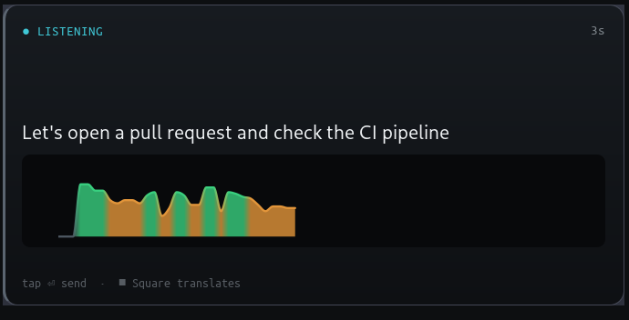
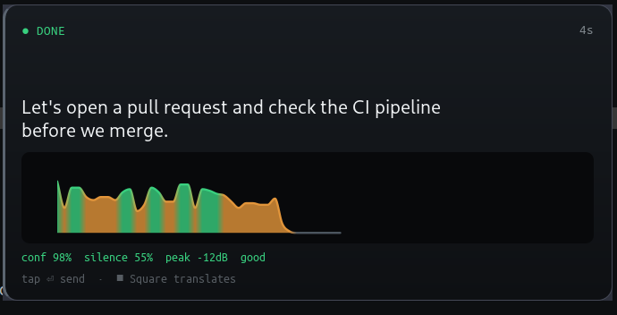

# talkey

Hold a key, speak, release. The text is typed into whatever window has focus.

Everything runs on your machine - whisper.cpp does the transcription, nothing is
uploaded, there is no API key and no account. For X11 with i3, or any window
manager that can bind a key's press *and* release.



A floating heads-up display shows the transcript forming as you speak, with a
live level meter. It never takes focus, so your text still lands in the window
you were working in.



On release the clean final text is typed, and the reading tells you how it went:
confidence, how much of the clip was silence, and your microphone's peak level.

## Contents

- [Why](#why)
- [What the keys do](#what-the-keys-do)
- [Install](#install)
- [Configuration](#configuration)
- [How it works](#how-it-works)
- [Microphone level](#microphone-level)
- [Vocabulary](#vocabulary)
- [Privacy: what is stored, and where](#privacy-what-is-stored-and-where)
- [Troubleshooting](#troubleshooting)
- [Contributing](#contributing)
- [Licence](#licence)

## Why

Dictation tools tend to be cloud services, or they take over your desktop, or
they only work inside one editor. talkey is a keybind. It types into the window
you are already in - a terminal, a browser, an editor, a chat box - and the
audio never leaves your machine.

It is built for long technical prose: prompts, commit messages, review comments,
issue descriptions. The things that are slow to type and easy to say.

## What the keys do

**Dictate** - hold to talk, release to type. Tap instead of holding and it goes
hands-free: tap once to start, again to stop. If you work in two languages, set
`TALKEY_LANG2` and bind a second key to `talkey dictate-alt` for it.

**Memo / translate** - on its own, hold to record and release to play the clip
straight back, so you can hear whether that came out right. During a dictation
the same key toggles **translate to English** for the clip: dictate in whatever
language you speak, tap it, and English lands in your window. whisper's
translate task only ever outputs English, so this is *your language* to English
and not the reverse - a limit of the model, not a setting. Tap it
twice quickly during a dictation and it **restarts** instead: the take so far is
thrown away and recording begins again, without letting go of the dictate key.

**Submit / cancel** - on its own, taps Enter. During a dictation each tap cycles
what will happen when you finish: send (type, then Enter) → cancel (throw it
away) → plain (type, no Enter) → round again. Nothing commits mid-sentence, so
you can tap, keep talking, and undo an accidental press by tapping again. The
HUD shows what is currently pending.

**Help** - a cheat sheet of your own bindings, in a floating window.

Start, stop and submit each play a short tone, so you know the state without
looking.

## Install

### Arch Linux

```bash
yay -S talkey-git
talkey-setup
```

`talkey-setup` asks the two questions no documentation can answer for you: which
speech model you want (they range from 142MB to 1.6GB, and the right one depends
on whether you have a GPU), and which keys you want to talk on - you press them,
it reads the keycodes. It then tells you how to get the model you picked, starts
the speech service, and writes the bindings file. Safe to re-run;
`talkey-setup keys` rebinds later.

It installs nothing for you. A model is an install however it arrives, and your
package manager is yours - so setup names the model, prints the AUR package, the
official `download-ggml-model.sh` command and the direct URL, and leaves the
choice of which to run to you.

`eww` comes with it, and is a real dependency rather than a nice-to-have -
without the HUD you dictate blind, with only tones and notifications. It is
AUR-only, so `makepkg -si` on its own cannot resolve it; an AUR helper can, or
install `eww` first.

### Already running whisper yourself?

Then skip all of it. talkey talks to a whisper.cpp server over HTTP, so point it
at yours and it never touches a model, a path, or a systemd unit:

```bash
TALKEY_WHISPER_URL=http://your-host:8910/inference
```

Set that in `~/.config/talkey/talkey.env`. Otherwise talkey starts a server for
you (`talkey-whisper.service` runs `talkey-whisper-server`, which resolves the
binary and the model), and that is the only reason it needs to know about models
at all.

### From a checkout

```bash
git clone https://github.com/yogh-io/talkey && cd talkey
setup/install.sh
```

The installer does the two things a package cannot - builds whisper.cpp into
`~/.local/opt/whisper.cpp` if no packaged copy exists, and installs the systemd
user units pointing at your checkout - then runs the same `talkey-setup`. Model,
service and keys are handled identically either way. Binaries and models live
outside the repo; only scripts and configuration are tracked.

Put `bin/` on your `PATH`, or use absolute paths in the key bindings.

### Bind your keys

`talkey-setup keys` does all of this - it reads your keycodes off the keyboard
and writes the file. The manual route, if you would rather:

1. Find the keycodes. Run this, then press each key with the `xev` window
   focused and read the number after `keycode`:

   ```bash
   xev | grep --line-buffered -oP 'keycode\s+\d+.*'
   ```

2. Copy the bindings and put your keycodes at the top of the copy:

   ```bash
   # installed from the AUR
   cp /usr/share/talkey/bindings/i3.conf ~/.config/i3/talkey.conf
   # from a checkout
   cp bindings/i3.conf ~/.config/i3/talkey.conf
   ```

3. Include it from `~/.config/i3/config`:

   ```
   include ~/.config/i3/talkey.conf
   ```

4. Reload i3 with `Mod+Shift+R`. Hold your dictate key, say something, release.

`talkey-setup` offers to add step 3 for you. It keeps a `.bak`, and i3's own
parser gets the veto - if i3 would reject the result your config is restored
exactly as it was. Say no and it prints the line for you to add yourself.

It also checks that the key you picked is not already bound to something else,
including in files your config `include`s, and names the file and line if it is.

Setup offers **Caps Lock** for dictate. It is the one key on every keyboard that
is reachable without moving your hand and does nothing anybody needs, so it is
the only default talkey suggests - and it stops being Caps Lock while talkey is
set up (`setxkbmap -option` with no argument undoes that).

Any key works. The ones that suit this best are keys you do not otherwise use,
within reach of a resting hand. Submit and memo have no default, because no key
is free on every keyboard and binding one you *do* use would be worse than
leaving it to you.

### Requirements

| | |
|---|---|
| Required | X11, `bash` 4+, `whisper-cpp`, `ffmpeg`, `xdotool`, `xset`, `curl`, and for the HUD `eww` + `inotify-tools` + `jq` |
| Sound | a PulseAudio-compatible server: PulseAudio itself, or PipeWire with `pipewire-pulse`. Recording is `ffmpeg -f pulse`, playback is `paplay`. |
| A speech model | `whisper.cpp-model-large-v3-turbo` (default), or any ggml model |
| Live text in the HUD as you speak | `python` - without it the HUD still shows state and the meter |
| Translate key | `whisper.cpp-model-small` - turbo dropped whisper's translate task |
| Key bindings | your window manager, or `sxhkd` / `xbindkeys` |
| Notifications | `libnotify` - the only feedback if you skip the HUD |
| Paste mode | `xclip` |
| Auto-titled recordings | `ollama` **and a model pulled into it** (`ollama pull qwen2.5:3b`), plus `jq` |

A GPU is not required, but `large-v3-turbo` really wants one. On CPU, use
`small.en` instead. With the CUDA toolkit installed, build a GPU copy from a
checkout - the build script is not part of the package - with
`WHISPER_CUDA=1 setup/build-whisper.sh`, then restart the service. Transcription
then comes back in well under a second. The build asks your card which
architecture to target, so there is nothing to configure.

A build in `~/.local` always wins over the distro package, so a GPU rebuild is
never quietly undone by the CPU-only build the package depends on.
`talkey-whisper` logs which binary and model it chose.

## Configuration

Everything is configurable, and every default already works. Nothing here needs
setting to use talkey.

Settings live in `~/.config/talkey/talkey.env`:

```bash
mkdir -p ~/.config/talkey
cp /usr/share/talkey/config/talkey.env.example ~/.config/talkey/talkey.env
```

The format is the same as a systemd `EnvironmentFile` - `KEY=value`, one per
line, `#` comments. It is parsed rather than sourced, so no shell code runs from
it. Only `TALKEY_*` names are read. Anything already set in the environment wins
over the file, so a per-binding override still works:

```
bindcode $key_dictate exec --no-startup-id env TALKEY_LANG=de talkey dictate press
```

Key bindings themselves live in your i3 include, as variables at the top of the
file - keycodes, mouse buttons, the help shortcut and the second language.

The most useful settings:

| Setting | Default | What it does |
|---|---|---|
| `TALKEY_LANG` | `en` | the language you dictate in |
| `TALKEY_LANG2` | *(unset)* | a second language, for `talkey dictate-alt` |
| `TALKEY_SOURCE` | `default` | microphone; see `pactl list sources short` |
| `TALKEY_MODEL_NAME` | `large-v3-turbo` | which model the server loads |
| `TALKEY_HUD_MONITOR` | *(primary)* | which display the HUD opens on, e.g. `DP-1` |
| `TALKEY_TYPE_DELAY` | `8` | milliseconds per character when typing |
| `TALKEY_PASTE` | `0` | `1` pastes via the clipboard instead of typing - instant, but clobbers your clipboard |
| `TALKEY_SUBMIT` | `0` | `1` presses Enter automatically after typing |
| `TALKEY_STREAM` | `1` | `0` turns off the live HUD; transcribe only on release |
| `TALKEY_SOUNDS` | `1` | `0` for silence |
| `TALKEY_ARCHIVE` | `1` | keep a `.wav` of every recording |
| `TALKEY_ARCHIVE_DIR` | `~/.local/share/talkey/recordings` | where those go |
| `TALKEY_ARCHIVE_TITLE` | `1` | name those recordings after what you said, using Ollama |
| `TALKEY_OLLAMA_MODEL` | `qwen2.5:3b` | which Ollama model writes the name - it must be pulled |
| `TALKEY_OLLAMA_URL` | `http://localhost:11434/api/generate` | where Ollama is |
| `TALKEY_HOLD_MS` | `450` | longer press than this counts as hold, shorter as a tap |
| `TALKEY_MAX_REC_S` | `120` | hard cap on one recording, so a stuck key cannot run away - raise it for long-form |

See [`config/talkey.env.example`](config/talkey.env.example) for the complete
list, including HUD geometry, meter thresholds, external tool paths and the
labels on the help sheet.

### Recordings named after what you said

Every dictation is kept as a `.wav`, and a directory of `dictate-20260728-1412.wav`
is not something anyone browses twice. So talkey asks a local Ollama for two or
three keywords from the transcript and puts them in the filename instead:
`dictate-20260728-1412-buy-groceries-pick.wav`.

This needs two things, not one: `ollama` installed **and** a model pulled into
it. The default is `qwen2.5:3b`, chosen because it is small and fast - a
"thinking" model spends longer deciding than the dictation took to record.

```bash
ollama pull qwen2.5:3b
```

Without Ollama running, recordings simply keep their timestamp name and nothing
is sent anywhere. With Ollama running but the model missing, talkey now says so
in `$XDG_RUNTIME_DIR/talkey/log` rather than leaving you to wonder why names
never appear. `TALKEY_ARCHIVE_TITLE=0` turns it off; see
[Privacy](#privacy-what-is-stored-and-where) for what gets sent where.

## How it works

```
hold ─┐                             ┌─ writes state files ─→ eww HUD
      ├─ i3 bindcode ─→ talkey ─────┤
rel ──┘                             ├─ ffmpeg -f pulse ─→ raw PCM  (record)
                                    ├─ pump: re-transcribe every ~0.3s ─→ transcript
                                    └─ on release: POST the clip ─→ whisper-server
                                                     │
                                       xdotool type (dictate) / paplay (memo)
```

`talkey MODE start|stop` is the whole runtime. `start` records raw PCM and, for
dictation, launches the live pump and writes the display state; `stop`
transcribes the complete clip and types it.

The **pump** re-transcribes the entire buffer every few tenths of a second, so
the HUD shows text evolving. Passing the full buffer each time is what makes it
tolerant of pauses - whisper sees the whole sentence, not a fragment.

The **server** stays resident as a systemd user unit, so the model is already
warm in memory. Each dictation is a fast POST rather than a cold model load.

The **HUD is a separate program**. talkey only writes state files; the eww
adapter watches those files with inotify and opens or closes the window on its
own: it appears when recording starts and stays until the text has been typed,
however long the transcription takes. State changes are event-driven - nothing
sits in a loop asking whether anything happened. (The level meter does sample the audio at a
fixed rate while you speak, because that is what a meter is; it blocks the rest
of the time.) Writing a
different renderer means reading those same files, and talkey needs no changes.

X11 **auto-repeat** is switched off for the bound keycodes, so holding a key is
one clean press and release rather than a machine-gun of events. A small watcher
reapplies that whenever a keyboard re-enumerates, because X quietly turns it
back on after a reconnect or a suspend.

### Long dictations

whisper only ever looks at 30 seconds of audio at a time. Longer input is not a
problem for it: after each window it moves forward to where the last sentence
ended and takes the next 30 seconds from there, so sentences are never cut in
half and a clip of any length comes back whole.

That only works if whisper is allowed to emit timestamps, because the timestamps
are how it knows where the sentence ended. `--no-timestamps` reads like a
formatting flag and is not one: with it, whisper has no boundary to seek to, so
it steps forward a blind 30 seconds each time and whatever straddles the cut is
mangled or lost. Nothing reports this - the text simply comes back a clause
short. On real dictations of 45 to 90 seconds it cost a phrase at every
boundary, once an entire "I move the mouse to another window" that the rest of
the sentence depended on.

So `talkey-whisper-server` does not pass it, and `talkey doctor` says so if the
server you are running does.

The practical limits are elsewhere, and both are yours to set:

- `TALKEY_MAX_REC_S` (default 120) stops the recording itself, so a stuck key
  cannot run away. Raise it for long-form dictation.
- `TALKEY_MAX_PUMP_S` (default 60) only pauses the **live preview**, whose cost
  grows with the buffer. The final transcript is unaffected and stays complete.

The wait for the final transcript scales with the clip rather than being capped,
so a long dictation on a CPU-only build is slow but never gives up early.

## Microphone level

Speech at a usable level is most of what whisper needs. Two failure modes recur.
Too hot - mic close, gain high - clips the loudest samples and loses detail. Too
faint leaves near-silence, which whisper fills with hallucinated filler: "thank
you", "thanks for watching". Both are measured straight from the audio as the
loudest sample in dBFS, in the same pass that measures silence.

**While you talk**, the meter is a scrolling trace. Each column is a moment: its
height is loudness, its colour the zone - orange too quiet, green good, red too
loud. The colour follows the recent peak envelope rather than the instant frame,
so natural dips between syllables do not flash orange when your level is fine.
Silence reads as a flat grey line, clearly different from merely quiet.

**After**, the reading grades that peak beside the confidence and silence
figures. It is a nudge to glance at, never a veto - sending is still your call.

**Across everything you have recorded**, `talkey-mic-check` sweeps the archive
and reports the distribution, a one-line verdict, and with `--worst` the hottest
and faintest clips. Run it to find out whether the microphone is set up right in
general, rather than for one dictation.

## Vocabulary

whisper's only vocabulary mechanism is an initial prompt - there is no lexicon
to load. talkey keeps one in `vocabulary.txt`, on by default, and it fixes the
proper nouns whisper reliably mishears.

Two things matter, both learned the hard way:

- **Write natural sentences, not a word list.** A comma-separated term dump is a
  style atypical of transcripts and destabilises the decoder - a long list has
  been observed to make it drop whole sentences.
- **Seed only what it actually gets wrong.** It already spells "TypeScript" and
  "Kubernetes" correctly. A growing list drifts back toward being a word list.

The prompt is applied only to dictations shorter than `TALKEY_VOCAB_MAX_S`
(default 28 seconds). A prompt is carried as context through the whole clip, so
the more speech it is applied to the more words it can quietly reword - a
"worktree select box" came back as "worktrees like box" - and long-form
dictation is left raw. Length itself is no longer the issue: see
[long dictations](#long-dictations).

## Privacy: what is stored, and where

Nothing leaves your machine. The only network calls are to `127.0.0.1` - the
whisper server, and Ollama. There is no telemetry and no account.

Ollama is worth spelling out, because it is **on by default**: to name a
recording after what you said, talkey sends that recording's full transcript to
`http://localhost:11434/api/generate` and uses the two or three words it gets
back as the filename. If nothing is listening on that port, or `jq` is missing,
the recording just keeps its timestamp name and nothing is sent. Turn it off
with `TALKEY_ARCHIVE_TITLE=0`, point it elsewhere with `TALKEY_OLLAMA_URL`, or
turn the archive off entirely with `TALKEY_ARCHIVE=0`.

Local storage is a different question, and worth knowing about:

| What | Where | Turn it off with |
|---|---|---|
| A `.wav` of every dictation and memo | `~/.local/share/talkey/recordings` | `TALKEY_ARCHIVE=0` |
| Transcript keywords in those filenames, via Ollama | same, on by default | `TALKEY_ARCHIVE_TITLE=0` |
| Live transcripts, raw audio, the log | `$XDG_RUNTIME_DIR/talkey` | cleared when you log out |

The archive is on by default and never pruned - it is what makes
`talkey-mic-check` and `talkey-replay` useful, but it does accumulate every word
you have dictated. To wipe it:

```bash
rm -rf ~/.local/share/talkey/recordings
```

The runtime directory holds raw microphone audio and the id of the window text
is typed into, so it is created private to you (`0700`), and talkey refuses to
start if it finds one owned by somebody else.

## Troubleshooting

**Start here:**

```bash
talkey doctor
```

It checks the whole chain in the order it has to work - X11 or Wayland, the
programs talkey needs, the model, the speech server, whether a key is bound and
whether i3 actually loaded it, the background helpers, and your microphone. For
anything wrong it prints one sentence and one command. It changes nothing.

Every error talkey can show you names it, so you never have to know which log to
read.

Then, if you want the detail:

```bash
tail -f "${XDG_RUNTIME_DIR:-/tmp}/talkey/log"   # what talkey is doing
tail -n 20 "${XDG_RUNTIME_DIR:-/tmp}/talkey/hud.log"  # why the HUD did not appear
systemctl --user status talkey-whisper          # the speech-to-text server
journalctl --user -u talkey-whisper -f          # its logs
talkey-diag                                     # the last dictation's live-path trace
talkey-mic-check --worst                        # microphone sweep of the archive
talkey-replay <recording.wav>                   # replay an archived clip through the
                                                # live pump, to see what it did
```

**Nothing happens when I press the key.** Check the binding fired:
`tail -f` the log while pressing. If nothing appears, i3 is not running the
command - confirm the keycode with `xev`, and note that i3 does not strip
comments from `set` values, so a trailing comment on a keycode line breaks it.

**The text appears in the wrong window.** talkey locks onto the window that had
focus when typing began. If your window manager moves focus during the
dictation, set `TALKEY_TARGET_WINDOW=1` (the default) and avoid clicking away
while it transcribes.

**No HUD.** It needs `eww` and `inotify-tools`. Check the adapter is running
(`talkey-hud`), and if you have more than one display, set `TALKEY_HUD_MONITOR`
- otherwise the HUD opens on the primary one, which may not be the one you are
looking at.

**Transcripts contain "thank you" or "thanks for watching".** That is whisper
hallucinating over near-silence. Your level is too low: run `talkey-mic-check`.

**A long dictation is missing a phrase every 30 seconds.** The speech server is
running with `--no-timestamps`, which makes it cut the audio into blind 30 second
blocks. If it is talkey's own server, it is one left over from before this was
fixed: `systemctl --user restart talkey-whisper`. See
[long dictations](#long-dictations).

**A long dictation stops after two minutes.** That is `TALKEY_MAX_REC_S`, the cap
on the recording, not on whisper. Raise it.

**A held key machine-guns.** X re-enabled auto-repeat, usually after a keyboard
reconnect or a suspend. `talkey-norepeat` should be running to catch that;
otherwise `xset -r <keycode>` fixes it until the next reconnect.

## Contributing

Issues and pull requests are welcome. Two conventions worth knowing before you
open one:

- **Nothing polls.** State changes arrive via inotify, hooks or events. A
  `sleep N; check; repeat` loop will be turned down.
- **The renderer stays thin.** talkey writes state files and knows nothing about
  how they are drawn. Logic belongs in the recorder, not the adapter.

Shell code is bash with `set -euo pipefail` where it can be. Run `bash -n` over
anything you change; there is no build step.

## Licence

MIT. See [LICENSE](LICENSE).
