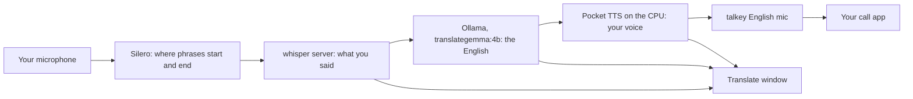
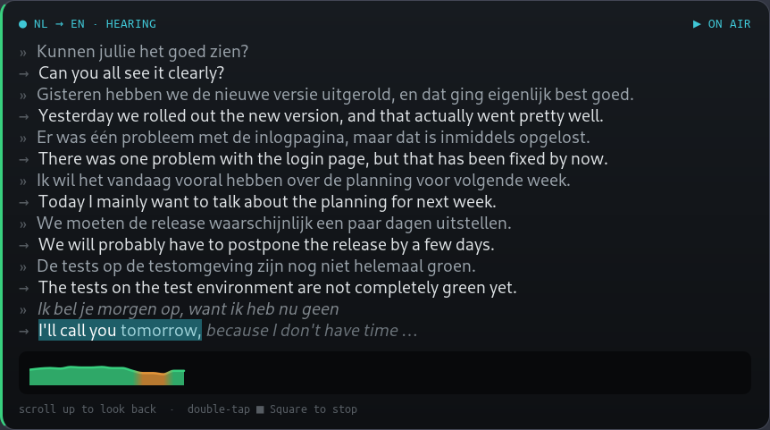

# Live translation in your own voice


Talk in your own language, and the people in your call hear you in English, in
your own voice, about two to three seconds behind you. talkey listens to your
microphone, translates what you say, and speaks it into a virtual microphone
called **talkey English mic**. You pick that microphone in your call app, just
like a headset. A window shows what it heard and what it said, and which English
your listeners hear right now.

[Watch the demo with sound](media/translate-demo.mp4) (22 seconds, Dutch in,
English out; the demo uses a stock voice, not a cloned one).

Everything runs on your own machine. Nothing is sent anywhere, and there is no
account or subscription. The one exception is a one-time download of the voice
model, described below.

- [How it works](#how-it-works)
- [Choosing the engine](#choosing-the-engine)
- [Install](#install)
- [Getting your voice right](#getting-your-voice-right)
- [Use it in a call](#use-it-in-a-call)
- [Give it context](#give-it-context)
- [What to expect](#what-to-expect)
- [Settings](#settings)
- [Listening back and debugging](#listening-back-and-debugging)
- [Privacy](#privacy)
- [Troubleshooting](#troubleshooting)

## How it works



1. **Phrases.** Silero, the same speech detector auto mode uses, notices when
   you start talking and when you pause.
2. **Transcribing while you talk.** Every quarter second, your whisper server
   transcribes everything you have said in the phrase so far. Your last two
   sentences go along as context, which helps whisper pick words that fit.
3. **Translating while you talk.** Each time, TranslateGemma translates the
   phrase so far, continuing the English that has already been spoken. It only
   gets the words whisper stands by: words that two transcriptions in a row have
   in the same place, or three when whisper itself is unsure of the word. The last word
   of a transcription is often still wrong, and a wrong word would make a wrong
   translation. The translate window shows everything whisper heard.
4. **Only speaking what is settled.** English is settled, word by word, when a
   later translation, made after you said more, still starts with the same words.
   Many languages, Dutch and German among them, put the verb at the end of the
   sentence. Until you say it, the model guesses one, and the guess changes when
   the real verb arrives. So a guess is not settled. There is one other way for
   English to be settled:
   after each draft, the same model is asked, as a plain language model, how
   likely it is that a sentence ends right after the words heard so far. When
   that chance is high enough, the whole draft may be spoken without waiting for
   more words. An open clause, still waiting for its verb, gets a chance near
   zero.
5. **Timing from the voice itself.** Settled English is handed to the voice
   when the voice is about to run out, so each piece carries all that is
   settled by then. A piece is held back when it is so short that the voice
   would fall silent in the middle of a sentence before the next piece is
   usually ready; talkey measures that time during the session. The pace of the
   voice follows the same measurements: a little slower when nothing more is
   coming soon, faster when English is waiting behind it.
6. **One continuous voice.** Pocket TTS speaks each piece as a continuation of
   the piece before it, so a sentence spoken in three pieces still sounds like
   one sentence. While it waits for the rest of a sentence, a soft tick tells
   the listeners you have not stopped talking. After a piece that may end a
   sentence, it stays silent.
7. **At your pause.** The whole phrase is transcribed once more, and whatever is
   still untranslated is translated and spoken.

The voice is **cloned, not trained**. Pocket TTS is a general English voice model.
Before it speaks, it is given a short recording of you, and it carries on as the
same speaker: your timbre, your accent, your intonation. The model itself never
changes. That is why a few seconds of recording are enough, and why the quality
of that recording matters so much (see [Getting your voice right](#getting-your-voice-right)).

## Choosing the engine

The steps above are the default engine, called `whisper`. There is an optional
second one, `seamless`: Meta's SeamlessStreaming, a model made to translate
speech while someone is still talking. It hears you and writes English as it
goes, about three times a second, and talkey speaks each whole English word with
the same voice and the same timing. While it translates it needs neither your
whisper server nor Ollama. The setting `TALKEY_TRANSLATE_ENGINE` picks the
engine. The translate window shows the one that runs in its bottom-right corner,
and `talkey translate status` names it.

Measured on 19 Dutch recordings of about 10 seconds each, played into a private
session on an RTX 3070 Ti with 8 GB:

| | whisper | seamless |
|---|---|---|
| English starts after you start talking (mean, median) | 3.2 s, 2.4 s | 2.2 s, 2.1 s |
| Last English after you stop talking | 4.6 s | 3.5 s |
| Silence between pieces of English, per recording | 1.6 s | 1.8 s |
| Pieces per recording | 5.3 | 7.2 |
| Ready after you switch translation on | 4 s | 8 s |
| How close the English is to a reference translation (chrF, higher is closer) | 63 | 62 |

What else is different with `seamless`:

- **No context.** It ignores your notes and the live context. The model has no
  way to take them.
- **It sometimes invents words**, or repeats some. The voice says them like any
  other English; talkey does not filter them. Watch the translate window.
- **The line in your own language is a second reading.** The same model writes
  it from the same audio, apart from the English, so the two can differ. It is
  less exact than whisper: about 22 words in 100 were wrong, against 10.
- **It needs a large GPU:** about 5 GB of VRAM for itself, and 13 GB of disk.
- **It needs your language named.** `TALKEY_TRANSLATE_FROM` must be `nl`, `de`,
  `fr`, `es`, `it` or `pt`; `auto` does not work.

**The licence.** The SeamlessStreaming weights are Meta's, licensed
CC-BY-NC-4.0: non-commercial use only. talkey does not ship them, never installs
them unless you ask, and the default engine does not use them.

### Install the Seamless engine

```bash
talkey-setup seamless
```

It shows the licence and asks first; the answer is no unless you type `y`. Then
it makes a Python 3.10 environment in `~/.local/share/talkey/seamless/venv` (it
needs `python3.10` or `uv`), installs PyTorch, fairseq2 and Meta's
seamless_communication into it (about 5.5 GB), and downloads the four weight
files (about 7.9 GB) from a fixed revision, each checked against its checksum.
It does not change your settings. To use the engine, add this to `talkey.env`
and switch translation off and on:

```
TALKEY_TRANSLATE_ENGINE=seamless
```

Check: `talkey doctor` shows `engine: seamless` and `the seamless engine is
ready`, and the translate window says `engine: seamless` in its corner.

The engine runs offline: it reads the weights from that folder and never
downloads anything while translating.

### GPU memory

Seamless takes about 5 GB of VRAM, nearly all of it when translation starts, so
a card that is too small fails right then rather than in the middle of a call. A
long phrase can still need a little more than it took at the start. On an 8 GB
card it does not fit next to the whisper server that dictation uses (about 2
GB), nor next to a loaded Ollama model. Without room, translation stops with
`translate stopped: not enough GPU memory for Seamless`, how much was free, and
which programs hold the rest.

To let Seamless take the whisper server's memory, add:

```
TALKEY_SEAMLESS_PAUSE_WHISPER=1
```

Starting translation then stops `talkey-whisper.service`, and stopping
translation, or an error, starts it again. While a dictation is still being
recorded or transcribed, translation does not start: it says `dictation is still
running`. In between there is no dictation: the dictation key says `dictation is
paused while Seamless translates`, and auto mode does not start. talkey does not
unload Ollama. If a translation model is still loaded from an earlier session,
free it with `ollama stop translategemma:4b`.

## Install

This assumes talkey itself already works: dictation types text, so your whisper
server runs. Each step ends with a check that shows what you should see. If you
use an AI assistant to help you install, point it at this section; the checks
tell it whether a step worked.

### What you need

| | |
|---|---|
| talkey | working dictation, with its whisper server running |
| Audio | PulseAudio, or PipeWire with `pipewire-pulse` (`pactl` and `pacat`, from `libpulse`) |
| Ollama | running locally, with room for a 3.3 GB model, recent enough to return token probabilities (`logprobs`) |
| Python | 3.10 to 3.14, with `venv` and `pip`; and `git`, because pip installs the voice model from git |
| GPU | the translator wants about 2.9 GB of VRAM next to your whisper model. An 8 GB card with whisper large-v3-turbo works. |
| CPU | the voice runs on one CPU core, about 2.5 times faster than real time on a desktop CPU |
| Disk | about 1.5 GB for the voice environment, 3.3 GB for the translation model |
| An account at huggingface.co | free, needed once to download the voice cloning model |

### 1. Get the translation model

```bash
ollama pull translategemma:4b
```

Check: `ollama list` shows `translategemma:4b`.

### 2. Install the voice in its own Python environment

The voice needs PyTorch, which talkey itself does not, so it gets its own
environment. Find talkey's `config` folder first: `/usr/share/talkey/config`
for the AUR package, or `config/` in your checkout.

```bash
python3 -m venv ~/.local/share/talkey/translate-venv
~/.local/share/talkey/translate-venv/bin/python -m pip install \
  -r /usr/share/talkey/config/translate-requirements.txt \
  --extra-index-url https://download.pytorch.org/whl/cpu
```

The extra index matters: without it, pip downloads the CUDA build of PyTorch,
several gigabytes the voice does not use. The requirements pin Pocket TTS to a
git commit that is newer than its latest release, because only that version can
continue speech across pieces.

Check: this prints `True`:

```bash
~/.local/share/talkey/translate-venv/bin/python -c 'import inspect; from pocket_tts import TTSModel
print("forced_latents" in inspect.signature(TTSModel._generate_audio_stream_short_text).parameters)'
```

If it prints `False`, pip kept an older Pocket TTS with the same version number.
Reinstall just that package with the line from the requirements file:

```bash
~/.local/share/talkey/translate-venv/bin/python -m pip install --force-reinstall --no-deps \
  "$(grep '^pocket-tts' /usr/share/talkey/config/translate-requirements.txt)"
```

### 3. Tell talkey where the environment is

Add this line to `~/.config/talkey/talkey.env`, with your own home folder. Values
in that file are taken literally, so `~` and `$HOME` do not work there.

```
TALKEY_TRANSLATE_PYTHON=/home/YOU/.local/share/talkey/translate-venv/bin/python
```

### 4. Unlock voice cloning, once

Kyutai, who make Pocket TTS, hand out the part that clones voices only after you
accept their terms, which forbid cloning anyone's voice without their consent.

1. Log in at https://huggingface.co, open https://huggingface.co/kyutai/pocket-tts
   and accept the terms. Access is granted immediately.
2. Create a token with read access at https://huggingface.co/settings/tokens.
3. Log in from the terminal and paste the token when asked:

   ```bash
   ~/.local/share/talkey/translate-venv/bin/hf auth login
   ```

Check: `~/.local/share/talkey/translate-venv/bin/hf auth whoami` shows your
account name.

### 5. Record your voice and clone it

```bash
talkey-setup translate
```

It shows a short English text, records 25 seconds of you reading it, warns if the
recording was too quiet, then downloads the cloning model and makes your voice.
Read the section below before you record; the recording decides how much the
result sounds like you. You can record again later by running the same command
and answering **y** to "record a new voice sample?".

Check: it ends with `+ translate mode ready: talkey translate toggle`.

### 6. Make sure the translator runs on the GPU

Start translation once (step 7 below), say a sentence, and run `ollama ps`. The
`PROCESSOR` column should say `100% GPU`. Ollama is careful with VRAM and may
put part of the model on the CPU, shown as for example `23%/77% CPU/GPU`, which
makes each translation about three times slower. If you have the room, force it
fully onto the GPU in `talkey.env`, then switch translation off and on:

```
TALKEY_TRANSLATE_GPU_LAYERS=99
```

### 7. Try it

Double-tap the memo key, or run `talkey translate toggle`. After a few seconds you
hear the auto-mode "on" sound. Say a sentence.

Check: `talkey translate status` shows `{"enabled":true,"state":"listening",...}`,
and `pactl list short sources` lists `talkey_translate_mic`. The translate window
opens while you speak.

## Getting your voice right

The clone copies whatever is in your recording: not just your voice, but your
microphone, the room, the noise and the speaking style. These are the things that
made the difference while this feature was developed, from "not my voice at all"
to "sounds like me, accent included":

1. **Record in English**, the language it will speak, reading the text at your
   normal pace, the way you talk in a call. Your accent in English is exactly
   what it will copy.
2. **Use the microphone you use in calls**, in a quiet room, close to your mouth.
   No music, fan or keyboard noise. `talkey-setup translate` warns when the peak
   level is below -20 dB; aim for a peak around -6 dB.
3. **Do not use old recordings**, such as talkey's dictation archive. Those are
   often 16 kHz audio, which cuts everything above 8 kHz, and the clone then
   sounds muffled. Do not join clips from different microphones either.
4. **Set the voice temperature to 0.45** in `talkey.env`:

   ```
   TALKEY_TRANSLATE_TEMP=0.45
   ```

   It controls how much variation the voice allows. Measured against real
   recordings with a speaker-similarity model, 0.45 sounded most like the
   speaker; Pocket's default of 0.3 sounded flatter, and at 1.0 words start to
   slur.
5. **Listen back** with recordings switched on (see
   [Listening back and debugging](#listening-back-and-debugging)), and record
   again if it does not sound like you.

**What about training a voice model?** It was tried, and it is not needed. Short
fine-tuning of Pocket TTS on half an hour of a speaker's recordings did not make
the clone sound more like them. Kyutai's repository does include a full
fine-tuning recipe (`training/configs/finetune.yaml` followed by
`depth_distill.yaml` in https://github.com/kyutai-labs/pocket-tts), but it wants
many hours of clean speech at 24 kHz or higher with transcripts, a GPU with about
16 GB, and hours of training. A good 25-second recording gets you most of the
way there in a minute.

## Use it in a call

1. Double-tap the memo key to start translating. Double-tap it again to stop.
2. In your call app (Discord, Zoom, Teams, Jitsi, a browser), choose
   **talkey English mic** as your microphone. It appears the first time you start
   translation, and it stays when you stop, silent, so your app keeps it selected.
3. Use headphones, so the English you hear from others does not reach your
   microphone.
4. Watch the translate window. It shows your words as they are heard and the
   English under them. If something was misheard or comes out wrong, say it
   again.



### The translate window

The window opens when you start talking and closes a few seconds after the last
English has played. It keeps the conversation, newest at the bottom:

- **»** what was heard, in grey. Slanted grey words are still being heard and can
  change.
- **→** the English. What your listeners hear right now has a teal background.
  Inside it, the words already spoken are white and the rest light teal.
- Slanted grey English is translated but not played yet. A **…** means more
  English is coming.
- **▶ ON AIR** in the corner means English is playing.
- The bottom-right corner names the engine that translates, for example
  `engine: whisper` (see [Choosing the engine](#choosing-the-engine)).

Which piece of English is playing is exact: talkey knows when it hands each piece
to the microphone. Where the voice is inside a piece is an estimate, from the
length of the words. Your call app adds its own small delay on top.

Scroll with the mouse wheel over the window to read back through the session,
up to the last 100 phrases. The corner then shows how many newer phrases are
below; scroll down to the end to follow along again. The window never takes the
keyboard focus, not even when you scroll it, so you keep typing in your call
app.


Translate mode and auto mode both act on everything you say, so starting one
stops the other. Push-to-talk dictation still works, but what you dictate is
also translated. While you dictate, the dictation HUD takes the translate
window's place.

### Subtitles on your camera

talkey can also put the subtitles on your video, so the people in your call can
read along and you can check yourself in your own preview. It is a virtual
camera called **talkey camera**: your webcam, with the phrase on air drawn at
the bottom. What you said is on top, slanted while it is still being heard; the
English is under it, marked the same way as in the translate window.

It needs the v4l2loopback kernel module, set up once:

```bash
sudo pacman -S v4l2loopback-dkms   # elsewhere: your distribution's v4l2loopback, with kernel headers
echo v4l2loopback | sudo tee /etc/modules-load.d/v4l2loopback.conf
echo 'options v4l2loopback devices=1 video_nr=10 card_label="talkey camera" exclusive_caps=1' \
  | sudo tee /etc/modprobe.d/v4l2loopback.conf
```

Then reboot. Browsers only list the camera with `exclusive_caps=1`, and talkey
finds it by the name `talkey camera`.

1. Start translating. When the talkey camera exists, it starts too.
2. In your call app, choose **talkey camera** as your camera.
3. Stopping translation leaves the camera on, without subtitles, so your call
   keeps its video. `talkey camera stop` turns it off, and `talkey camera start`
   turns it on without translating.

Your webcam only runs while an app shows the talkey camera, so its light goes off
when you leave the call, even with the camera on. Until the webcam has started,
the app gets a black picture. The subtitles appear when you start talking and stay
a few seconds after the English has played, like the translate window.

Most call apps mirror your own preview, so the subtitles look backwards to you
but read normally for everyone else. Most apps can switch the mirroring off in
their video settings.

Call apps crop your video to fit their tiles. Jitsi uses a portrait tile when
there is little room and keeps only the middle of the picture. So the subtitles
stay in the middle part, shaped 3:4, which a portrait tile still shows whole.
`TALKEY_CAMERA_CAPTION_ASPECT` changes that shape: `16:9` uses the full width,
`9:16` fits a phone screen.

## Give it context

A 4B translation model only sees a few sentences. It does not know what you
are talking about, so a Dutch "hij" about a program becomes "he", and names
come out wrong. Tell it, before or during a call:

- **Notes** in `~/.config/talkey/translate-notes.txt`: the topic, the names of
  people and products, terms that must stay as they are. Any language works.
  For example: `Weekly planning with the design team. Names: Anna, Bram. Keep "sprint" in English.`
- **Live context** in `$XDG_RUNTIME_DIR/talkey/translate.context`: any program
  may write or append to this file while translation runs, for example the
  agenda item you are on. Its newest part is used. It is removed when
  translation starts.

Both are read again when you start a new phrase, so a change applies from your
next sentence. The translator sees them as context and does not translate them;
whisper gets them too, which helps it spell names. Keep them short: the context
takes room in the model's prompt and costs a little time per translation.

## What to expect

This is the default engine; for the Seamless engine, see
[Choosing the engine](#choosing-the-engine).

- **Delay.** The English usually starts about 3 seconds after you start a
  sentence, often before you finish it. talkey waits until it has some settled
  English, so the voice rarely stops right after a fragment. It cannot start much
  earlier without speaking guesses or short fragments.
- **Pauses in the English.** Most sentences flow without a break. When the rest
  of a sentence is not settled yet, the voice waits, usually for less than a
  second and a half, with a soft tick so listeners know you are still talking.
  The English ends about four seconds after you stop talking.
- **Mistakes.** Whisper sometimes mishears the first words of a phrase, and a 4B
  translation model gets some idioms and expressions wrong, for example Dutch
  times: "half elf" is 10:30, not 11:30. The translate window shows both what
  was heard and what was said.
- **Your voice.** The listeners hear your voice, so they will take its mistakes as
  yours. Where it matters, tell people you are using live translation.

## Settings

All of these go in `~/.config/talkey/talkey.env`. Switch translation off and on
after changing them.

| Setting | Default | Meaning |
|---|---|---|
| `TALKEY_TRANSLATE_ENGINE` | `whisper` | The engine that translates: `whisper`, or `seamless` (see [Choosing the engine](#choosing-the-engine)) |
| `TALKEY_SEAMLESS_HOME` | `~/.local/share/talkey/seamless` | Where the Seamless engine's `venv/` and `models/` are |
| `TALKEY_SEAMLESS_PAUSE_WHISPER` | `0` | `1` stops `talkey-whisper.service` while Seamless translates, for its GPU memory; no dictation meanwhile |
| `TALKEY_TRANSLATE_PYTHON` | `python3` | The Python with Pocket TTS installed |
| `TALKEY_TRANSLATE_VOICE` | `~/.local/share/talkey/translate/voice.safetensors` | Your cloned voice |
| `TALKEY_TRANSLATE_FROM` | `nl` | The language you speak, as a whisper code; `auto` lets whisper guess per phrase |
| `TALKEY_TRANSLATE_NOTES` | `~/.config/talkey/translate-notes.txt` | Your notes on the conversation, see [Give it context](#give-it-context) |
| `TALKEY_TRANSLATE_LLM` | `translategemma:4b` | The Ollama model that translates |
| `TALKEY_TRANSLATE_GPU_LAYERS` | unset | `99` forces the whole translation model onto the GPU |
| `TALKEY_TRANSLATE_URL` | `http://127.0.0.1:11434/api/chat` | Ollama's chat endpoint |
| `TALKEY_TRANSLATE_TTS` | `english` | The Pocket TTS model |
| `TALKEY_TRANSLATE_TEMP` | Pocket's `0.3` | Voice temperature; `0.45` sounded most like the speaker |
| `TALKEY_TRANSLATE_SPEED` | `0.95` | The usual pace of the voice, without changing its pitch; below 1 is slower. `1` keeps Pocket's own pace. The voice goes down to 0.9 times this when no more English is coming soon, and up to 1.2 times while English waits |
| `TALKEY_TRANSLATE_TICK` | `1` | Tick softly while the voice waits for the rest of a sentence (not after one that may have ended); `0` stays silent |
| `TALKEY_TRANSLATE_SILENCE_MS` | `500` | The pause that ends a phrase |
| `TALKEY_TRANSLATE_MAX_S` | `15` | The longest phrase; it is cut here even without a pause |
| `TALKEY_TRANSLATE_MONITOR` | `0` | `1` also plays the English on your own output; use headphones |
| `TALKEY_TRANSLATE_RECORD` | `0` | `1` keeps each phrase's audio, see below |
| `TALKEY_TRANSLATE_TRACE` | `0` | `1` logs the timing of each phrase, see below |
| `TALKEY_TRANSLATE_SINK`, `TALKEY_TRANSLATE_MIC` | `talkey_translate`, `talkey_translate_mic` | The sink and microphone the English goes to. Other names run a second, private instance beside yours, for example to test |
| `TALKEY_TRANSLATE_CAMERA` | `1` | Start the talkey camera with translation when it exists; `0` leaves it to `talkey camera start` |
| `TALKEY_CAMERA_INPUT` | your first webcam | The webcam the talkey camera shows, like `/dev/video0` |
| `TALKEY_CAMERA_SIZE` | `1280x720` | Size of the talkey camera; the webcam is scaled and cropped to fill it |
| `TALKEY_CAMERA_FPS` | `30` | Frames per second of the talkey camera |
| `TALKEY_CAMERA_CAPTION_ASPECT` | `3:4` | Shape of the middle part of the picture the subtitles stay in, as WIDTH:HEIGHT, so apps that crop your video still show them |

For a status bar, `talkey translate status` prints one JSON object, for example
`{"enabled":true,"state":"hearing","engine":"whisper","microphone":"talkey_translate_mic"}`.
The state is `off`, `starting`, `listening`, `hearing` or `error`. The engine is
the one that runs, or, while translation is off, the one that would start.
`talkey translate toggle` switches it from a click. `talkey camera status`
prints `{"enabled":true,"device":"/dev/video10"}`, with an empty device when
there is no talkey camera.

## Listening back and debugging

Every phrase is logged while translation runs:

```bash
tail -f "$XDG_RUNTIME_DIR/talkey/translate.current/lines.log"
```

Each entry shows what was heard, the English, the pieces it was spoken in, when
the voice began (counted from when you began, and from your pause; negative means
before it), how long the voice waited between pieces, and whether the voice ever
stuttered because it was generated too slowly.

With `TALKEY_TRANSLATE_RECORD=1`, every phrase also keeps two files in
`~/.local/share/talkey/recordings/translate/<session start>/`:

- `001-nl.wav`: what you said, exactly as whisper got it. Listen to this when
  something was misheard.
- `001-en.wav`: the English exactly as the microphone carried it, with the real
  pauses between pieces and the ticks in them. This is what your call heard.

The session folder has its own `lines.log`, whose entries name the two files.

With `TALKEY_TRANSLATE_TRACE=1`, the worker writes `trace.jsonl` next to
`lines.log`: one JSON line per event, with the phrase number `n` and `t`, the
seconds since you began that phrase. It shows when you started and stopped
talking, each transcription of the phrase so far and each draft translation,
with how long they took, why a draft was spoken or held back, when each piece
was handed to the voice, when its first audio was made, and when it played.
With the Seamless engine it has each step of the model instead of the
transcriptions and drafts: how much of your audio it had heard, how long the
step took, the new English words, and the words in your language.
Use it to find where the time goes.

To check that the English really reaches the microphone, record it directly while
you speak:

```bash
parecord --device=talkey_translate_mic check.wav
```

## Privacy

- Nothing leaves your machine while translating. A session runs with
  `HF_HUB_OFFLINE=1`; only `talkey-setup translate` downloads the voice model,
  and only `talkey-setup seamless` the Seamless weights.
- Your recording and your cloned voice live in `~/.local/share/talkey/translate`,
  readable only by you. They are never part of talkey's repository or package.
- Recordings of your calls are off by default (`TALKEY_TRANSLATE_RECORD`).
- Your notes and the live context only go to the local translator and whisper.
  They are not written to `lines.log` or the trace.
- `lines.log` with the text of each phrase lives in `$XDG_RUNTIME_DIR/talkey`,
  which is normally cleared when you log out.
- The talkey camera never stores a frame. Your webcam's picture goes straight to
  the virtual camera, and only while an app shows it.

## Troubleshooting

**"translate mode unavailable: ...".** Something is missing, and the message
says what. For the voice, `talkey-setup translate` checks each of steps 2 to 5
and says which one; for the Seamless engine, `talkey-setup seamless`.

**"translate stopped: ...".** Translation stopped after an error, and the
message says why. The talkey log has the rest.

**"not enough GPU memory for Seamless".** The message says how much was free and
which programs hold the rest. Set `TALKEY_SEAMLESS_PAUSE_WHISPER=1`, unload an
Ollama model with `ollama stop`, or use the default engine. See
[GPU memory](#gpu-memory).

**"dictation is paused while Seamless translates".** With
`TALKEY_SEAMLESS_PAUSE_WHISPER=1`, the whisper server is stopped while Seamless
translates. Stop translating to dictate. If a translate session was killed and
left it stopped, the next dictation starts it again.

**"your input is the talkey English mic".** Your system's default microphone is
set to the virtual one, so talkey would translate its own output. Set your real
microphone as the default.

**It takes long to start, or the English is slow.** Run `ollama ps` while
translating. If it does not say `100% GPU`, see step 6. Something else using the
GPU, like a game, can push the model onto the CPU.

**Nobody hears you.** Check that your call app has **talkey English mic**
selected and is not muted. To rule out talkey, record the microphone as shown
above while you speak.

**It sounds choppy in a browser call.** Browsers run every microphone through
noise suppression, automatic gain and echo cancellation, which are tuned for
human voices. Switch noise suppression off for this microphone if your call app
allows it.

**Testing on your own.** Joining your own call twice in the same browser does
not work well: the browser's echo cancellation hears the translation playing in
one tab and removes it from the microphone in the other. Join from your phone
to listen, or record the microphone as shown above.

**The voice does not sound like you.** See
[Getting your voice right](#getting-your-voice-right).

**Your call app does not list the talkey camera.** `talkey camera status` should
show a device; if the device is empty, the module is not loaded or has another
name (see [Subtitles on your camera](#subtitles-on-your-camera)). The camera must
be on before the app looks for cameras: run `talkey camera start`, then pick the
camera again in the app. If the picture stays black, another app may have your
webcam open; the log says so.

**Anything else.** talkey's log is `$XDG_RUNTIME_DIR/talkey/log`, and
`talkey doctor` checks the rest of talkey.
